# Guide illustré de la plateforme XTER Transit

> Ce guide présente toutes les parties du site avec captures d'écran réelles (prises sur cette
> installation). Les données visibles sur les captures étaient une **démonstration temporaire**
> créée pour la documentation puis supprimée — votre base ne contient que vos données réelles.
>
> Les captures se trouvent dans le dossier `docs/captures/` (ouvrir ce fichier dans VS Code ou
> sur GitHub pour voir les images).

---

## 1. Le site public

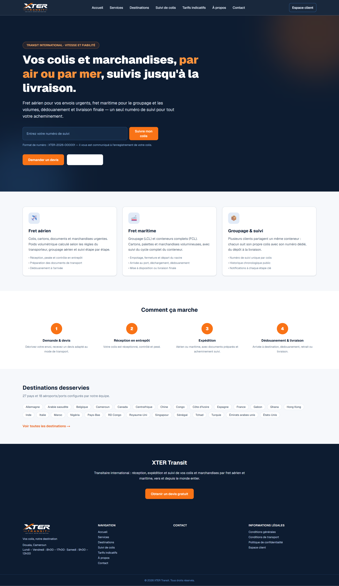

**L'accueil** présente l'entreprise avec votre logo, la promesse « Transit international · Vitesse et
fiabilité », et surtout le **champ central de suivi** : un client saisit son numéro (format
`XTER-2026-000001`) et clique sur « Suivre mon colis » — aucun compte n'est nécessaire. Viennent
ensuite la présentation du fret aérien, du fret maritime et du groupage, puis les destinations
desservies (celles que vous avez activées) et un appel à demander un devis.

Le site est **entièrement responsive** — même page sur smartphone :

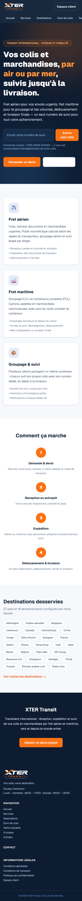

### Le suivi public

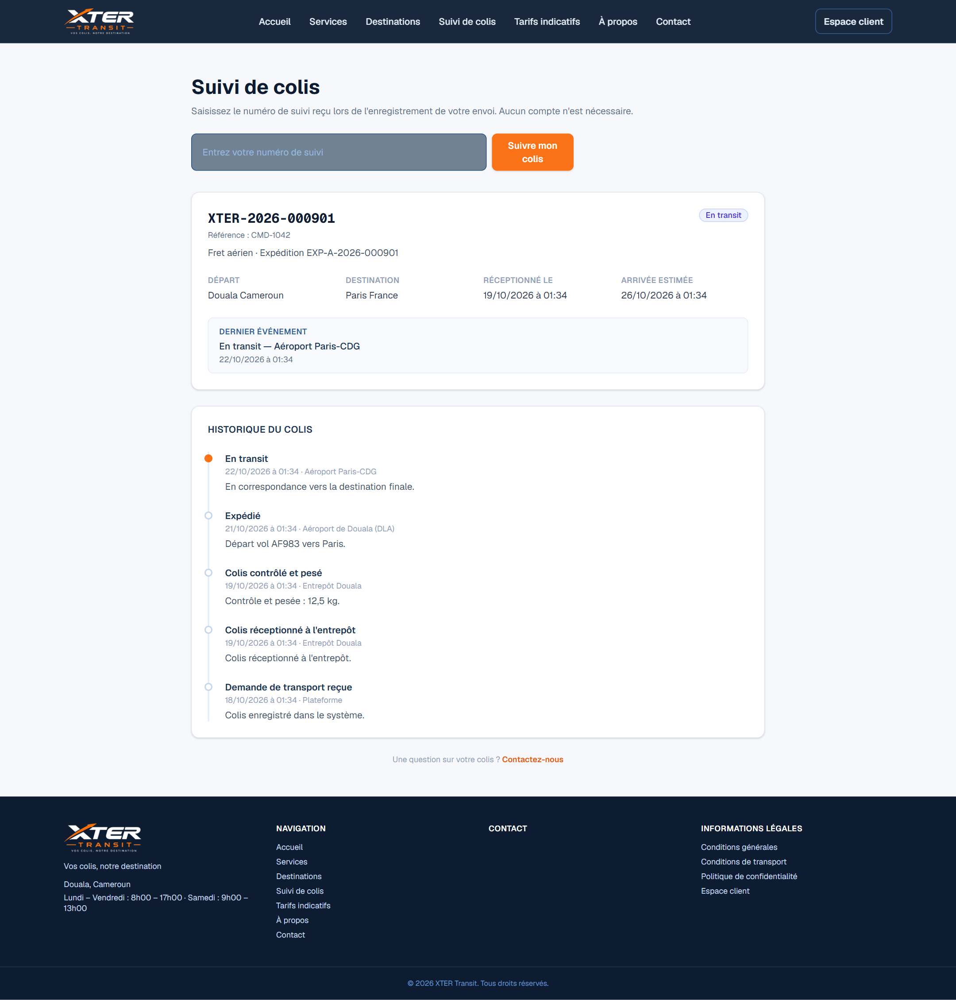

La page de suivi affiche : le mode de transport, la ville/pays de départ et de destination, le statut
actuel (ici « En transit », avec le point orange = dernier événement), la dernière position connue
(« Aéroport Paris-CDG »), et **l'historique chronologique complet** — y compris les événements
propagés depuis l'expédition (marqués « Expédition »). Aucune donnée personnelle (adresses,
téléphones, noms complets) n'y apparaît jamais.

Sur mobile, un client retrouve la même information :

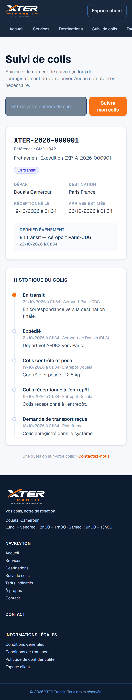

### Devis, contact, destinations

| Page | Rôle |
|---|---|
| 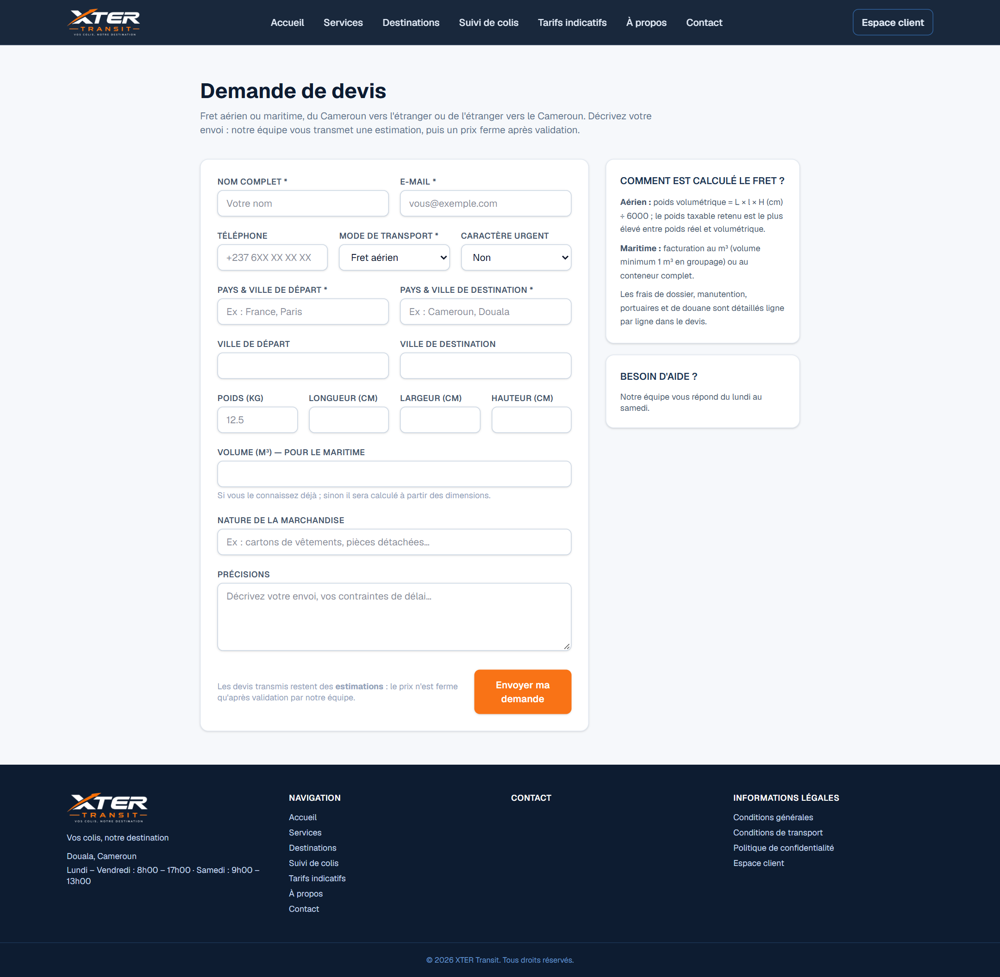 | **Demande de devis** : le client décrit son envoi (mode, trajet, poids/dimensions ou volume, urgence). La demande arrive dans « Devis » de la console avec le statut *Nouvelle demande*. |
| 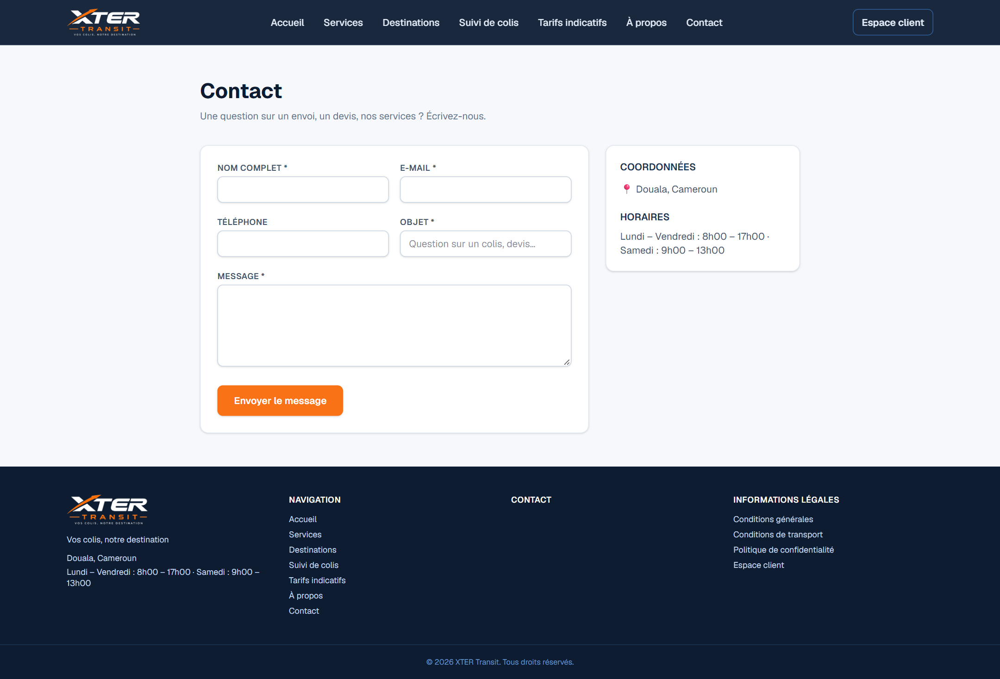 | **Contact** : message transmis à votre équipe (journalisé ; e-mail réel si SMTP configuré). Le bouton WhatsApp apparaît si vous avez renseigné votre numéro dans Paramètres. |
| 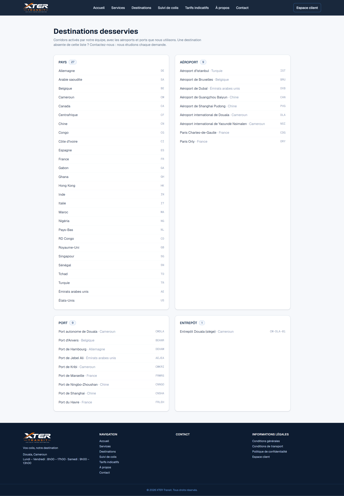 | **Destinations** : pays, aéroports, ports et entrepôts que vous avez publiés. S'administre dans Référentiels → Destinations. |

---

## 2. La console d'administration

Connexion sur `/connexion` avec votre compte (rôle : Super administrateur, Administrateur, Agent de
transit, Responsable d'entrepôt, Comptable, Responsable des expéditions, Agent de livraison).
Chaque rôle ne voit que les sections autorisées — par exemple un comptable n'a pas accès aux colis,
et un agent de livraison ne voit que ses tournées.

### Tableau de bord

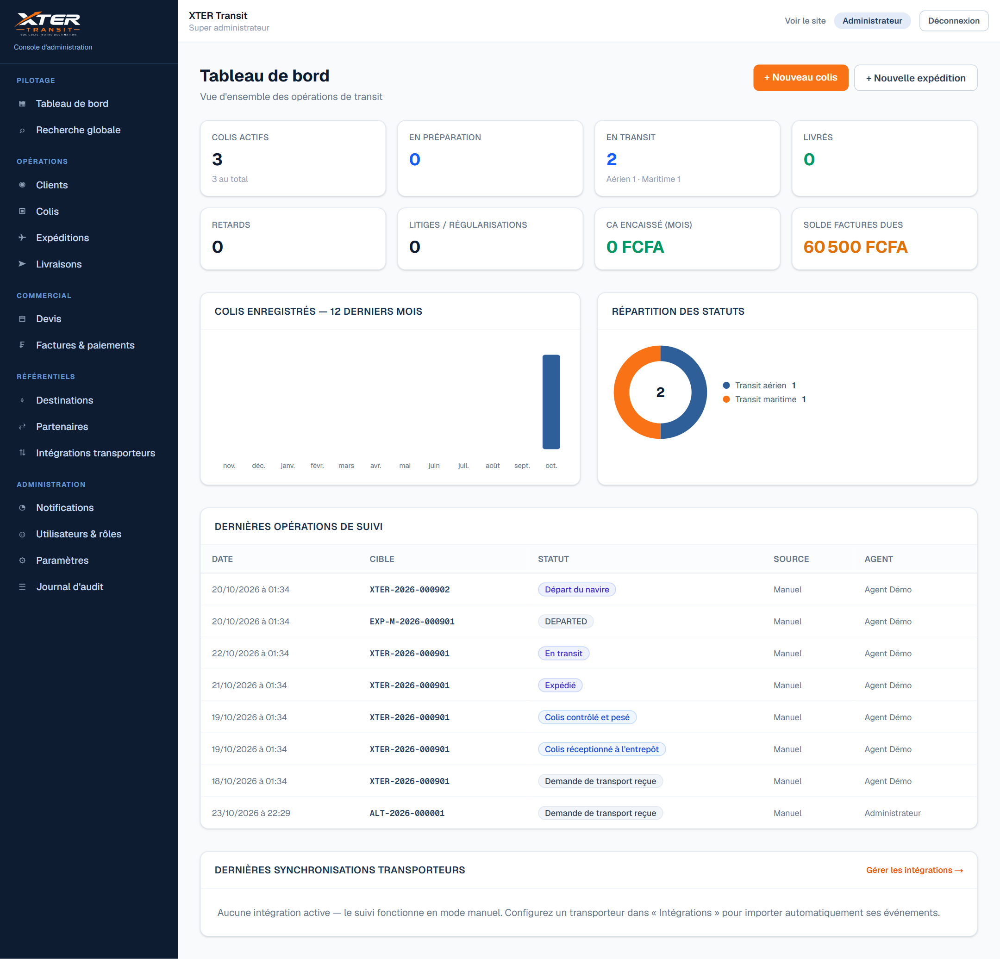

Indicateurs clés : colis actifs, en préparation, en transit (aérien/maritime), livrés, retards,
litiges, chiffre d'affaires encaissé du mois, solde des factures dues ; graphique des colis des
12 derniers mois, répartition par statut, dernières opérations de suivi et état des
synchronisations transporteurs.

### Fiche colis

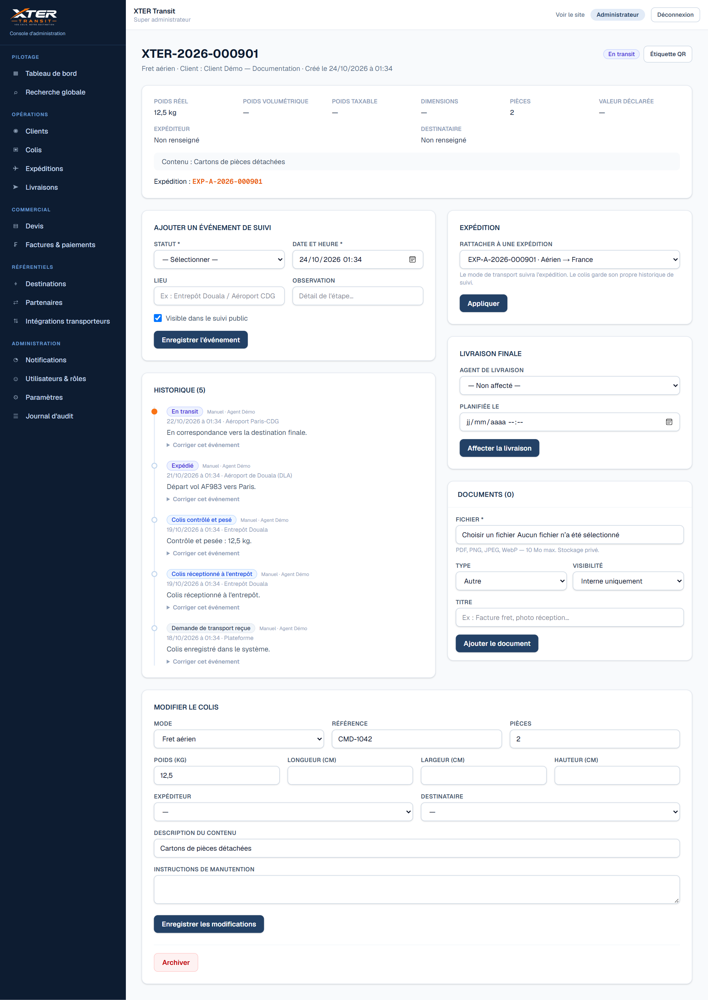

C'est le cœur opérationnel : poids (réel, volumétrique, taxable), pièces, valeur déclarée,
expéditeur/destinataire, documents joints, rattachement à une expédition, affectation de la
livraison. Le panneau **« Ajouter un événement de suivi »** enregistre chaque étape (statut adapté
au mode de transport, date/heure, lieu, observation, visibilité publique oui/non). L'**historique**
ci-dessous conserve tout : les corrections créent un nouvel événement et marquent l'ancien
« corrigé — conservé pour audit », rien ne s'efface silencieusement.

### Étiquette QR

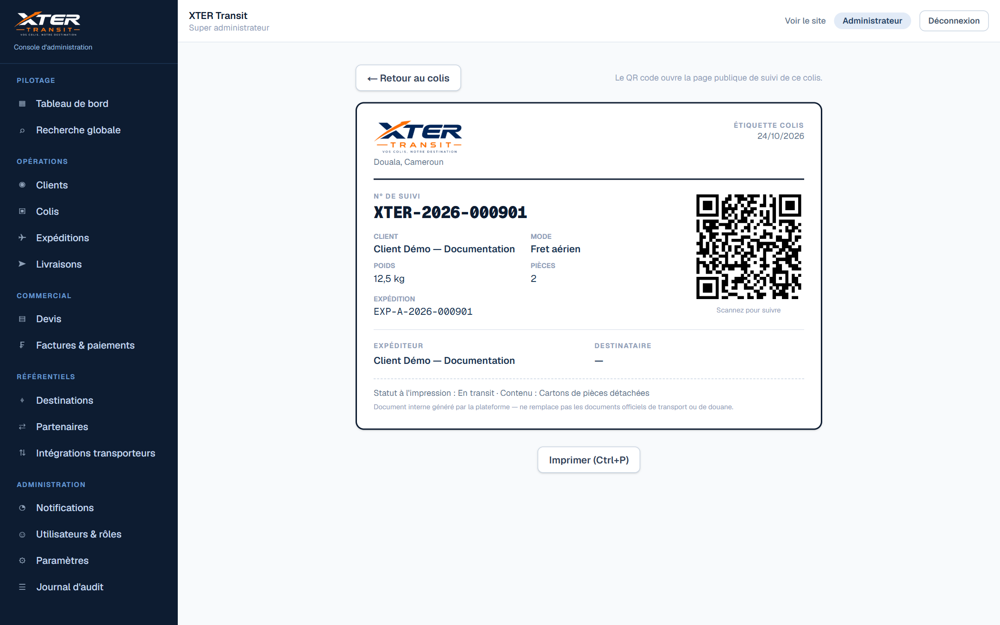

Imprimable en A4 ou sur étiquette : le **QR code ouvre directement la page publique de suivi** du
colis sur n'importe quel téléphone. Document interne : il ne remplace pas les documents officiels
de transport.

### Expédition aérienne — vols réels (API Amadeus) et assistant AWB

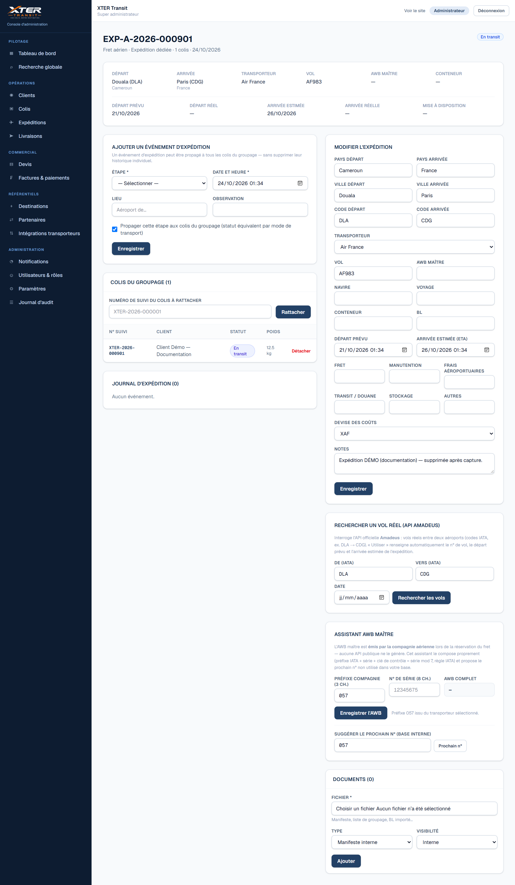

C'est la page qui répond à votre besoin « remplir automatiquement le n° de vol selon le pays de
départ et de destination » :

- **Panneau « Rechercher un vol réel (API Amadeus) »** : saisissez les codes aéroports IATA
  (pré-remplis depuis l'expédition — ex. `DLA` Douala → `CDG` Paris) et la date. La plateforme
  interroge l'API officielle **Amadeus** et liste les vols réels : compagnie + n° de vol
  (`AF983`), horaires de départ/arrivée, escales. Un clic sur **« Utiliser ce vol »** renseigne
  automatiquement le n° de vol, le départ prévu et l'arrivée estimée de l'expédition —
  la source est tracée dans l'audit.
- **Assistant AWB maître** (voir capture suivante) pour le numéro de lettre de transport aérien.
- Au centre : les **événements d'expédition** avec l'option « Propager cette étape aux colis du
  groupage », et la liste des colis rattachés.

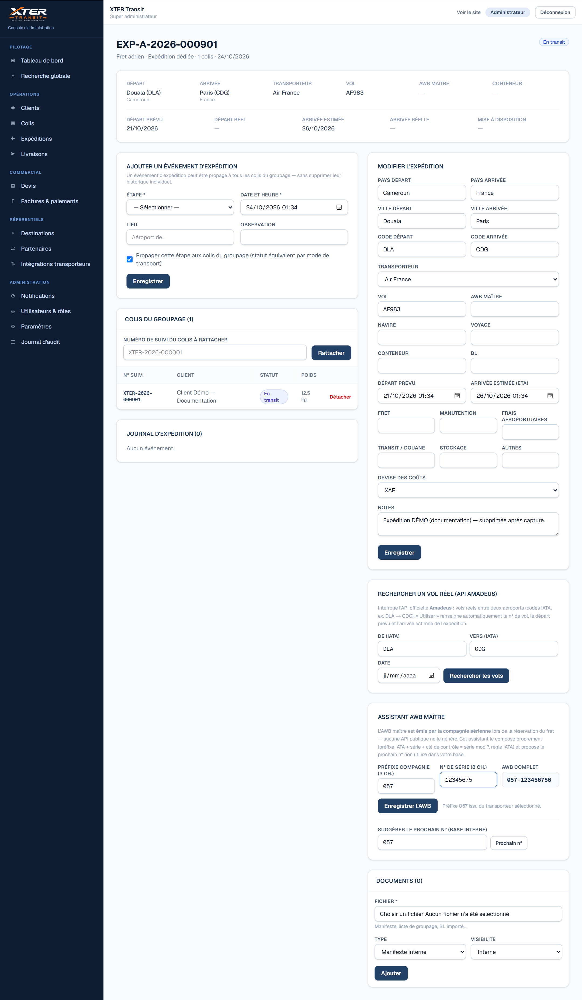

**Important (honnêteté) : le numéro AWB maître est émis par la compagnie aérienne** au moment de la
réservation du fret — aucune API publique ne peut le « deviner ». L'assistant fait ce qui est
possible et fiable :

1. **Préfixe IATA** de la compagnie (pré-rempli si le transporteur est sélectionné — 057 Air France,
   176 Emirates SkyCargo, 235 Turkish… pré-chargés dans « Partenaires ») ;
2. **n° de série** à 8 chiffres que vous saisissez (ou le **prochain n° non utilisé** de votre base,
   proposé en un clic) ;
3. **clé de contrôle calculée automatiquement** (série mod 7 — règle IATA) : ici `057-123456755` ;
   les doublons d'AWB entre expéditions sont bloqués.

### Groupage maritime

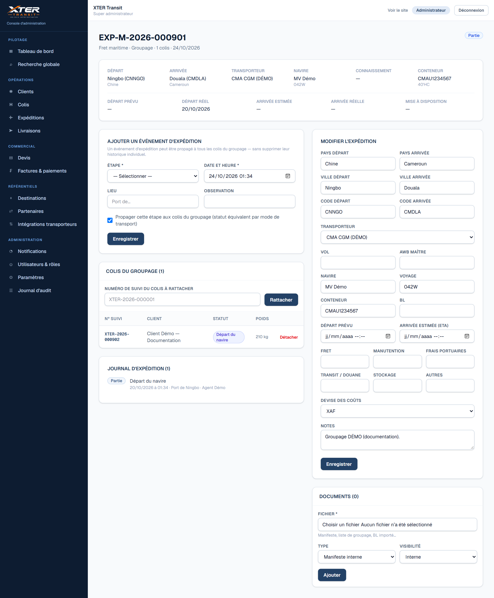

Même logique en maritime : navire, voyage, conteneur (n° + type), connaissement (BL), dates du cycle
(chargement, départ, ETA, déchargement, mise à disposition) et coûts (fret, manutention, frais
portuaires, douane, stockage). En mode **groupage**, rattachez plusieurs clients dans le même
conteneur : chaque colis **garde son propre numéro de suivi et son historique**, et un événement du
navire (ex. « Départ du navire ») peut mettre à jour tous les colis du groupe.

### Facturation

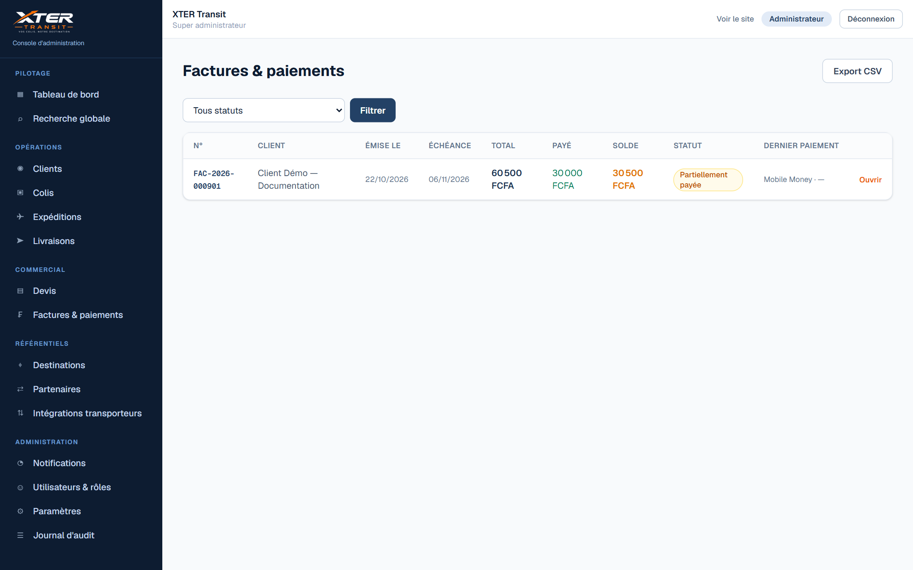

Liste des factures avec total, payé, **solde restant** et statut (Émise / Partiellement payée /
Payée / Annulée). Les paiements manuels (espèces, virement, Mobile Money) sont confirmés par un agent ;
le paiement en ligne reste en attente jusqu'à confirmation du prestataire. Export CSV disponible.

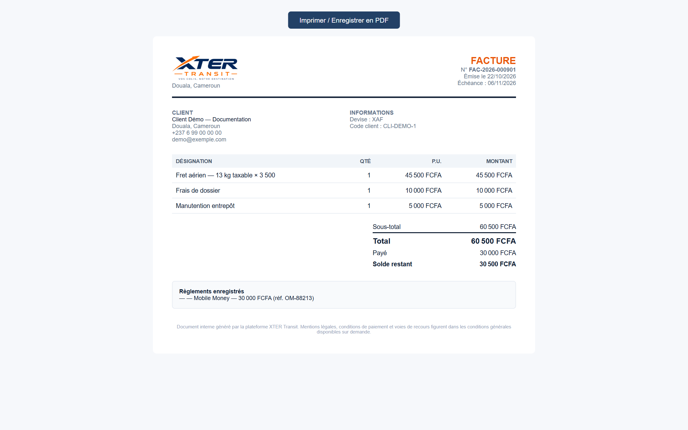

Chaque facture/reçu s'imprime en A4 avec votre logo et le détail des règlements —
« Imprimer / Enregistrer en PDF » depuis le navigateur.

---

## 3. Activer la recherche automatique de vols (Amadeus) — 5 minutes

1. Créez un compte **gratuit** sur <https://developers.amadeus.com> (Self-Service).
2. Dans « My apps », copiez votre **API Key** et **API Secret**.
3. Dans le fichier `.env` du projet, renseignez :
   ```
   AMADEUS_CLIENT_ID="votre clé"
   AMADEUS_CLIENT_SECRET="votre secret"
   AMADEUS_ENV="test"        # environnement d'essai gratuit ; "production" en exploitation
   ```
4. Redémarrez le serveur (`npm start`). Le panneau « Rechercher un vol réel » des expéditions
   aériennes devient opérationnel immédiatement.

Tant que ce n'est pas configuré, le panneau affiche ces instructions — **aucun vol n'est inventé**.

---

## 4. Ce que la plateforme ne simule jamais

- Les événements transporteurs automatiques : uniquement via une **intégration configurée**
  (Intégrations → API REST, webhook signé, ou import CSV) ;
- Les envois d'e-mails : réels uniquement si **SMTP** est configuré, sinon journalisés ;
- Les paiements en ligne : confirmation du **prestataire** obligatoire ;
- Les tarifs : uniquement les grilles que **vous** saisissez ;
- Les documents générés restent des documents internes tant que non validés par l'autorité compétente.

---

## 5. Comptes et accès

| Rôle | Accès |
|---|---|
| Super administrateur | Tout, y compris utilisateurs et paramètres |
| Administrateur | Tout sauf gestion des comptes (selon matrice) |
| Agent de transit | Clients, colis, suivi, devis |
| Responsable d'entrepôt | Réceptions, préparation, colis |
| Comptable | Devis, factures, paiements, rapports |
| Responsable des expéditions | Expéditions, groupage, livraisons |
| Agent de livraison | Ses tournées uniquement (mobile) |
| Client | Uniquement ses colis, factures et documents (`/espace-client`) |

Compte initial : `admin@xter-transit.local` (mot de passe à changer à la première connexion).
